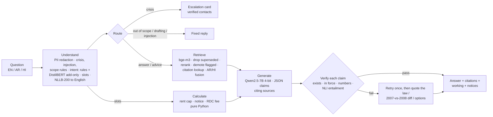

# Musta'jir

**A grounded, multilingual assistant for Dubai residential tenancy law.**

[](https://colab.research.google.com/github/bettinacodes/dubai-tenancy-assistant/blob/main/notebooks/00_Mustajir_demo.ipynb)


Ask a question about renting a home in Dubai, in English, Arabic or Hindi. Musta'jir answers **only from Dubai
tenancy legislation and official guidance**. It cites every provision, computes rent and notice limits in code, and
**checks every generated claim against the text it cites before showing it**. If a summary can't be verified, it
quotes the law instead. Everything runs on open models on a free Colab GPU: no paid API, and no question leaves the
runtime.

> **Not legal advice.** Musta'jir explains what the law says. The English texts are translations; the Arabic
> text of Dubai legislation prevails. The corpus is a snapshot as at **9 October 2026**.

## Results

| English, 50 gold + 20 adversarial questions | No retrieval (Qwen2.5-7B) | **Musta'jir (Qwen2.5-7B, Colab T4)** |
|---|---|---|
| Answers citing a law that doesn't exist in Dubai's framework | 46/50 | **0** |
| Answers showing a claim the cited text doesn't support | n/a | **0** (32% without the validator) |
| Correct binding provision cited | 0/39 | 0.69 |
| Rent and notice calculations correct | 1/7 | **9/9** |
| Must-refuse questions answered anyway | 11/13 | **0/13** |
| Latency p50 / p95 | — | **7.7 s / 20.8 s** |
| Demo acceptance script | — | **9/9** |

Retrieval on the held-out test split: the binding article is in the top 10 for 85% of questions; hit@10 is 0.94.
Full tables, ablations and the Arabic/Hindi parity results are in `notebooks/02` and `notebooks/03`.

## Quickstart (Google Colab, free tier)

1. Open [`notebooks/00_Mustajir_demo.ipynb`](notebooks/00_Mustajir_demo.ipynb) in Colab (badge above).
2. Runtime → Change runtime type → **T4 GPU**, then Runtime → **Run all**.

The first run takes about 15–20 minutes. It installs packages and Ollama, downloads the models, builds the index,
trains the intent classifier, runs the acceptance script and the 70-question benchmark, then opens the app with a
public share link. To repeat a run, use Runtime → *Disconnect and delete runtime* first, so the GPU starts empty.

## Run locally

```bash
python -m venv .venv && .venv/Scripts/activate        # Linux/macOS: source .venv/bin/activate
pip install torch --index-url https://download.pytorch.org/whl/cu124   # or the CPU build
pip install -r requirements.txt && pip install --no-deps -e .
ollama pull qwen2.5:3b                                 # https://ollama.com; the local generator
python -m tenancy_rag build-index
python -m tenancy_rag.understand.distilbert_clf train --seeds 0 1 2
python -m tenancy_rag ask "How much notice must my landlord give to raise the rent?"
pytest -q                                              # 180 tests
```

On a 4 GB GPU, set `TENANCY_EMBED_DEVICE=cpu` so the query embedder leaves room for the reranker and the LLM.

## How it works



**Numbers come from code, authority from retrieval, only fluency from the model.**

## Repository layout

| Path | Contents |
|---|---|
| `notebooks/00_Mustajir_demo.ipynb` | **Demo:** setup → index → assistant → acceptance script → T4 benchmark → Gradio app |
| `notebooks/01`–`04` | Corpus and pre-processing · retrieval evaluation · end-to-end evaluation · intent fine-tuning |
| `notebooks/_build_nb*.py` | The scripts that generate each notebook (the notebooks are built, not hand-edited) |
| `src/tenancy_rag/ingest`, `preprocess` | Polite fetcher with SHA-256 manifest; legislation, FAQ and PDF parsers; normalisation; structure-aware chunking |
| `src/tenancy_rag/index`, `retrieve` | Embeddings, Chroma, BM25; filters, reranker, fusion, citation lookup |
| `src/tenancy_rag/understand`, `guardrails` | Router, slots, intent models; PII, injection, scope and crisis guardrails |
| `src/tenancy_rag/tools` | Rent-increase, notice and RDC-fee calculators; every constant carries its source URL |
| `src/tenancy_rag/generate` | Citation-contract prompts, generation control flow, citation validator |
| `src/tenancy_rag/pipeline.py`, `ui.py`, `llm.py` | End-to-end assistant; Gradio front end; Ollama / transformers backends with a disk cache |
| `src/tenancy_rag/eval` | Retrieval, understanding, end-to-end and parity evaluation |
| `data/raw`, `data/processed` | Cached official sources (hash-checked; third-party API keys redacted) and the parsed corpus |
| `data/eval` | Gold (50), adversarial (20), Arabic/Hindi parity sets, intent data, saved runs |
| `tests/` | 180 tests: parsers, chunking, calculators (every boundary), validator, guardrails, imports |

## Reproducing the results

Every number above comes from a notebook cell or a saved run file.

```bash
make corpus            # parse + chunk the cached sources (make fetch re-downloads them)
make index             # build the dense indexes
make eval              # retrieval, understanding and end-to-end evaluation (needs Ollama)
make notebooks         # re-execute notebooks 01-04 from the saved runs
make test
```

Notebooks 02 and 03 rebuild their tables from the saved runs in `data/eval/runs/` in seconds. LLM calls are
cached on disk, so re-scoring never needs to regenerate.

## Data and ethics

- **Sources and provenance:** [`DATA_PROVENANCE.md`](DATA_PROVENANCE.md). Official government pages only, fetched
  politely with `robots.txt` checks. Each file's SHA-256 is recorded and re-checked.
- **Risks and mitigations:** [`ETHICS.md`](ETHICS.md).

## Limitations

- The evaluation set is small (50 gold questions) and was written by a single non-lawyer annotator.
- Arabic and Hindi were tested with machine-translated questions, not native-speaker ones.
- Routing rules are English-only; non-English questions are routed via their translation.
- The corpus is a snapshot of English translations; amendments after 9 October 2026 are not covered.

## License

The code is released under the [MIT License](LICENSE). The cached legislation and guidance in `data/raw/`
are public government publications, included only to reproduce the results; they remain subject to their
publishers' terms and are not covered by this licence.
